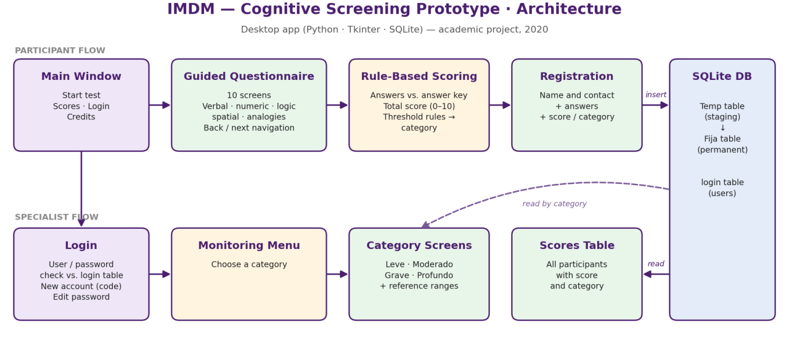

# 🧠 IMDM: Cognitive Screening Prototype (Expert Systems Course)

A desktop prototype built in 2020 for the **Expert Systems** course of my Mechatronics Engineering degree (CETI Colomos). It runs a short reasoning questionnaire, scores the answers against a rule set, stores the results in a local database and lets authorized users review records by category.

> ⚠️ **Academic project, not a clinical tool.**

 It was designed as a proof of concept under the guidance of a psychologist and a pedagogy specialist. A 10-question score cannot diagnose intellectual disability; real assessment requires standardized instruments administered by qualified professionals.

---

## 🎯 The idea

Specialists in our community pointed out a lack of accessible tools to organize cognitive screenings, especially for families with limited resources. The goal was a **lightweight desktop app** that could run on low-spec computers, guide the person through the questionnaire and keep a simple local registry for follow-up.

---

## 🧩 What I built

I was responsible for the **GUI and the database**; the domain experts defined the idea and the assessment criteria.

| Component | Implementation |
|---|---|
| **Questionnaire flow** | 10 multiple-choice screens (verbal, numeric series, logic, spatial and analogies), with forward/back navigation and progress indicator |
| **Rule-based scoring** | Answers compared with an answer key; the total score is mapped to a category through threshold rules |
| **Participant registry** | Registration form saved to SQLite through a temporary → permanent table flow |
| **Access control** | Login, account registration protected by an access code and password editing |
| **Monitoring screens** | Authorized users can list registered participants by category |

**Stack:** `Python` · `Tkinter` · `Pillow` · `SQLite`

---

## 🔁 Looking back (2020 → today)

I revisited this code years later with a data quality and testing mindset. These are the issues I would fix today:

| Issue found | Impact | How I would fix it |
|---|---|---|
| Category labels saved by the scoring step didn't match the labels queried by the monitoring screens | Some categories could never be listed | Single source of truth for categories (an `Enum` or lookup table) |
| An `if / else` chain overwrote the category for most scores | Only one category was stored correctly | Proper `if / elif` rules plus unit tests for every score |
| Scores above a threshold had no category | Silent blank values in the database | Explicit, complete rule table validated with tests |
| Passwords stored in plain text, hard-coded access code | Security risk | Hashed passwords and configuration outside the code |
| Personal data (name, address, phone) stored unencrypted | Privacy risk with sensitive health-related data | Data minimization, pseudonymous IDs and encryption |
| One function per screen with heavy global state | Hard to maintain or extend | Data-driven questions and a single reusable screen |
| Scores table reachable from the main window without login | Anyone could see all participants' results | Put every screen with personal data behind authentication |

This review is the most valuable part of the project for me: **the same bugs I now catch for a living** (inconsistent labels, silent nulls, missing validation) were all here.

👉 See a cleaned-up version of the scoring logic: [`snippets/scoring_rules.py`](snippets/scoring_rules.py)

---

## 📁 About this repository

Showcase repository. The original source code, question content and images are not published.

**Credits:** idea and domain expertise by María de Lourdes Arceo Aguilera (Pedagogy) and Antonio de Jesús Vale Vega (Psychology). GUI and database by Luis Raúl Núñez Arceo.

**Luis Raúl Núñez Arceo** · [LinkedIn](https://www.linkedin.com/in/luisraulnunezarceo/)

© 2020 Luis Raúl Núñez Arceo. All rights reserved.
